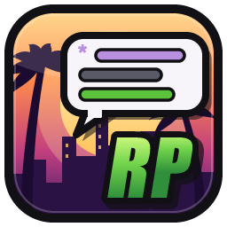
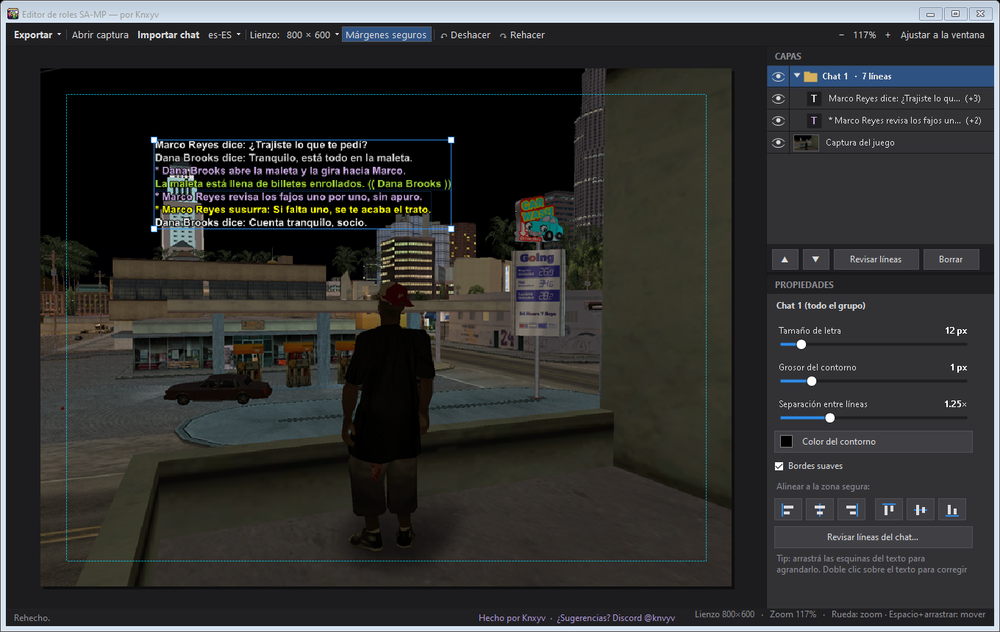
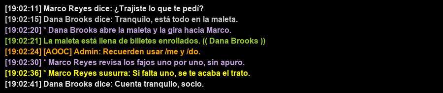
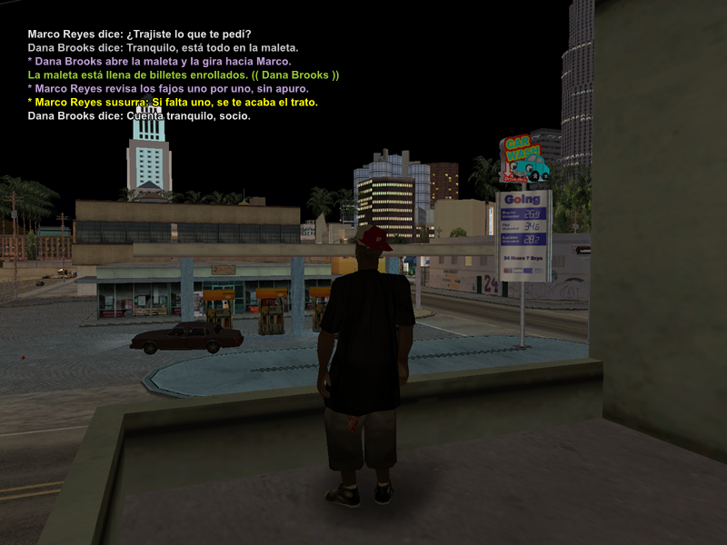

<p align="center"></p>

<h1 align="center">Editor de roles SA-MP</h1>

<p align="center"><b>Screenshots de rol para los foros, sin Photoshop.</b><br>
Abrí la captura, importá el chat y exportá. Todo con el mouse.</p>

<p align="center"></p>

---

## ⬇️ Descargar

1. Entrá a **[Releases](../../releases/latest)** y bajá `EditorRoles.exe` (un solo archivo, ~150 KB).
2. Doble clic. **No se instala nada.**

> 🔏 **El `.exe` lo compila GitHub, no la PC de nadie**: cada versión se arma en las máquinas de GitHub a partir de
> este código (ver [`.github/workflows/compilar.yml`](.github/workflows/compilar.yml)) y lleva un **sello de origen**
> verificable. Para comprobarlo, con la herramienta [`gh`](https://cli.github.com):
> ```
> gh attestation verify EditorRoles.exe --repo knayakong/editor-roles-samp
> ```

> **¿Windows dice «Windows protegió su PC»?** Es porque el programa no tiene una firma digital paga, no porque tenga
> algo malo. Tocá **Más información → Ejecutar de todas formas**, o: clic derecho en el `.exe` → **Propiedades** →
> marcar **Desbloquear** → Aceptar. Si desconfiás, el código completo está acá y lo podés compilar vos mismo
> (ver [Compilarlo vos mismo](#-compilarlo-vos-mismo)).

## ✅ Qué necesitás

- **Windows 10 o 11.** (Windows 7/8 no.)
- Nada más. Usa lo que ya trae Windows: el lector de texto (OCR), el corrector ortográfico y la fuente Arial.
- Si tu Windows **no está en español**, funciona igual con el lector en inglés (≈98 % en chats con fondo negro).
  Para el 100 %, agregá **solo** el lector español, sin cambiar el idioma de tu Windows
  (PowerShell como administrador, una vez):
  ```
  Add-WindowsCapability -Online -Name "Language.OCR~~~es-ES~0.0.1.0"
  ```

## 🎮 Cómo se usa

1. **Elegí el tamaño** al abrir: **800 × 600** (el de los foros), **1200 × 500** (panorámico) o personalizado.
2. **Abrir captura** → la foto del juego, sin chat (F8 en SA-MP). Arrastrala y usá las **esquinas** para agrandarla o achicarla.
3. **Importar chat** → la imagen donde se ve el chat. Lo ideal: el chat sobre **fondo negro** (se lee perfecto).
   - El programa detecta solo los **/me, /do, lo hablado, los susurros y el teléfono** por su color, y
     **quita la hora** y lo que no es chat (nombres sobre las cabezas, dinero, calles).
   - En la ventana de revisión marcás las líneas extra que quieras y corregís alguna palabra si hace falta.
     *No se pueden escribir líneas a mano: todo sale de la captura.*
4. **Acomodá** con el mouse: arrastrá, agrandá desde las esquinas, y usá las **guías magenta** que pegan el texto
   a los márgenes y al centro. La línea punteada es la **zona segura** (no sale en la imagen).
5. **Exportar** → **PNG** (máxima calidad) o **JPG** (pesa menos).

A la derecha están las **capas**: cada chat importado es un grupo, que se parte solo en trozos para que los puedas
separar. Abajo, las **propiedades**: tamaño de letra, grosor y color del contorno, separación entre líneas y botones
para alinear. **Ctrl+Z** deshace.

<p align="center"><br>
<sub>Entrada: el chat (nombres inventados)</sub><br><br>
<br>
<sub>Salida: la screenshot terminada</sub></p>

## 🔒 Privacidad y seguridad

- **No usa internet.** El código no tiene ni una conexión de red: no envía tus capturas a ningún lado, no se
  actualiza solo, no tiene publicidad ni telemetría. Podés comprobarlo leyendo `src/`.
- **Sin librerías de terceros**: sólo piezas de Microsoft que ya trae Windows (.NET Framework, el OCR de Windows y
  su corrector ortográfico).
- Lo único que escribe en tu disco es la imagen que exportás (y un archivo temporal mientras lee el chat, que se borra).

## 🧠 Cómo lee el chat (para curiosos)

La letra del chat de SA-MP es un color sólido con contorno negro. El programa separa cada línea **por su color**
(así el fondo del juego no molesta), la lee con el OCR de Windows y decide qué es cada cosa:

| Color | Qué es |
|---|---|
| morado | `/me` y `/do` (y las acciones automáticas `> …`) |
| gris / blanco | hablado (`dice`, `grita`, `[bajo]`, `por micrófono`, `en voz alta`) |
| amarillo | susurros y teléfono |
| verde | `/do` de entorno (los avisos del servidor quedan afuera) |

Además repara lo que el OCR suele confundir: la `/` leída como `l`, letras repetidas pegadas (`Bfff`), signos metidos
en medio de palabras y la hora mal leída. **No le corrige la ortografía al jugador**: copia lo que se escribió.

## 🛠 Compilarlo vos mismo

No hace falta Visual Studio: Windows ya trae el compilador de C#.

1. Bajá el código (**Code → Download ZIP**) y descomprimilo.
2. Doble clic en **`compilar.bat`** → aparece `EditorRoles.exe` al lado.

Un `.exe` compilado en tu propio PC no muestra el aviso de SmartScreen.

## 💬 Sugerencias

¿Encontraste un error o tenés una idea? Abrí un **[Issue](../../issues)** o escribile a **Knxyv** por Discord: **@knvyv**.

## 📄 Licencia

**MIT**: lo podés usar, copiar, modificar y compartir gratis, también en tu servidor o comunidad. Sólo mantené el aviso
de autoría (ver [`LICENSE`](LICENSE)).

*Hecho por **Knxyv**. No está afiliado a Rockstar Games, Take-Two ni al equipo de SA-MP; «GTA San Andreas» y «SA-MP»
se nombran sólo para describir para qué sirve.*
